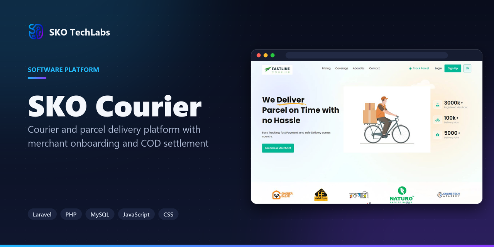
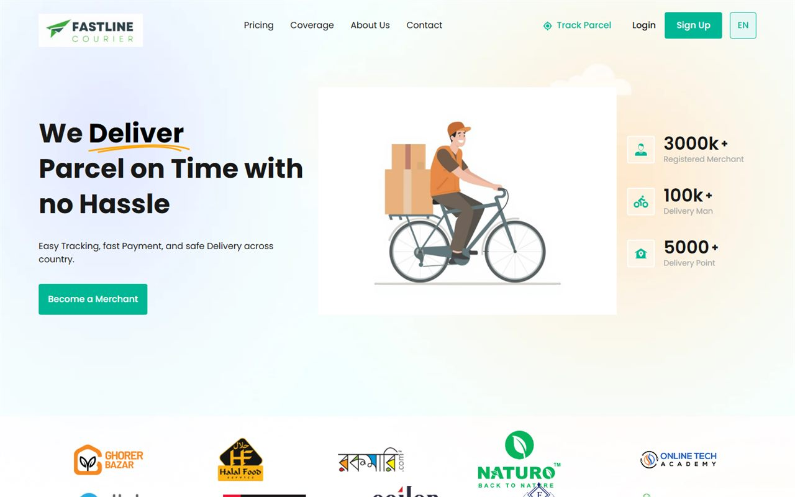

<h3>Courier and parcel delivery platform with merchant onboarding and COD settlement</h3>

Courier and parcel platform with merchant onboarding, unlimited daily pickups, a tracking code on every consignment and cash-on-delivery settlement.

   

<a href="https://courier1.skotechlabs.com"><b>Live Demo</b></a> &nbsp;·&nbsp; <a href="https://skotechlabs.com/projects/sko-courier-parcel-delivery-platform"><b>Case Study</b></a> &nbsp;·&nbsp; <a href="https://skotechlabs.com/contact"><b>Request a Demo</b></a> &nbsp;·&nbsp; <a href="https://github.com/skotechlabs"><b>All Products</b></a>

---

## Overview

A working courier platform built around the way parcel delivery actually runs here. Merchants sign up, book a pickup, and follow every consignment through a tracking code that belongs to that parcel alone.

Cash collected on delivery is held against the merchant account and paid back through cash, bank transfer or mobile banking, so the money and the parcel are never tracked in two different places.

<table>
<tr>
<td width="50%" valign="top">

### The Challenge

Small merchants selling over social media hand parcels to whoever is available and then chase the money by phone. Nobody can say where a parcel is, and cash-on-delivery settlement turns into a weekly argument over a paper ledger.

</td>
<td width="50%" valign="top">

### Our Solution

One platform where the merchant, the parcel and the money stay attached to each other. Every consignment gets its own tracking code, every status change is recorded, and cash collected on delivery settles against the merchant account instead of a note in a book.

</td>
</tr>
</table>

## Key Features

- Merchant registration and self-service dashboard
- Daily pickup requests with no consignment limit
- A unique tracking code on every parcel
- Cash-on-delivery collection and settlement
- Payout by cash, bank transfer or mobile banking
- Coverage area and delivery charge lookup
- Parcel status timeline for merchant and recipient
- Support desk with hotline and contact routing

## Business Impact

- Every consignment traceable by code, from pickup through to delivery
- Cash-on-delivery collected and settled per merchant
- Merchants raise their own pickups instead of phoning them in
- Coverage and delivery charges published rather than quoted case by case

## Screenshots

<table>
<tr>
<td width="50%" valign="top"> SKO Courier: Courier and parcel delivery platform with merchant onboarding and COD settlement</td>
<td width="50%"></td>
</tr>
</table>

> See it running: **[courier1.skotechlabs.com](https://courier1.skotechlabs.com)**

## Technology Stack

## Source Code & Licensing

This repository is the public showcase for **SKO Courier**. The production source code is proprietary and is maintained privately by SKO TechLabs.

Interested in this product for your business? We offer:

- **Ready-to-launch deployment** of SKO Courier under your own brand and domain
- **Customisation** of features, workflows, languages and integrations to fit how you work
- **Custom development** of a new product built on the same foundations
- **Ongoing support**, hosting, maintenance and feature roll-outs after launch

## Get in Touch

---

© 2026 <a href="https://skotechlabs.com">SKO TechLabs</a> · Dhaka, Bangladesh · Building intelligent digital solutions

